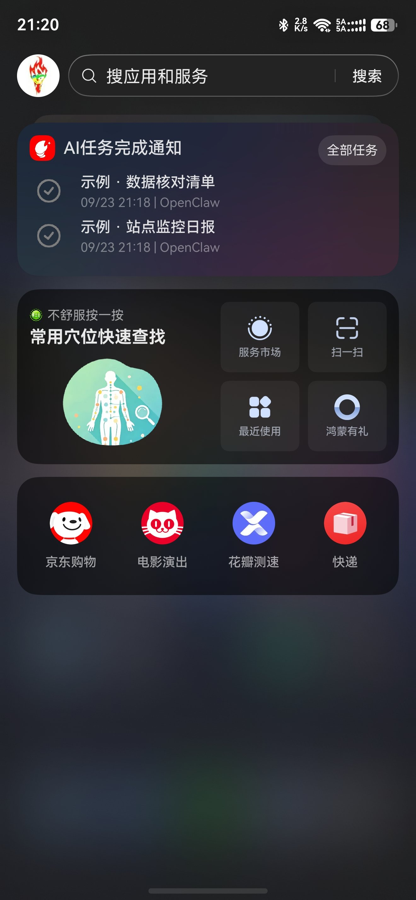
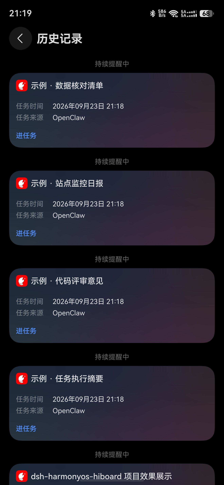
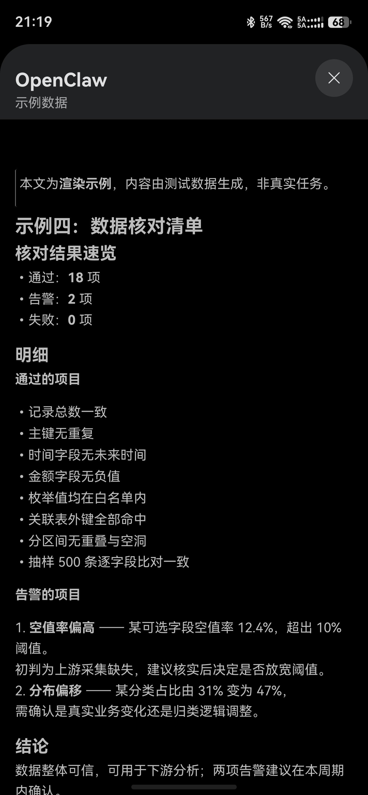

# 把 DSH 的任务结果，推送到华为鸿蒙负一屏

**Push DSH task results to Huawei HarmonyOS assistant-today cards**

[](LICENSE)
[](#)
[](#兼容性)
[](#)
[](https://www.npmjs.com/package/dsh-harmonyos-hiboard)
[](https://dsh-plugin.org/plugins/maybemeibemaybi/dsh-harmonyos-hiboard)

用 DeepSeek Harness（下称 **dsh**）干活时，结果都留在电脑屏幕上。这个插件把**每一轮的结论**
做成一张**服务卡片**，推到华为手机的**负一屏**（智慧助手·今天）—— 人不在电脑前，
掏出手机点开就能看到完整的正文。

**一句话：电脑上跑完，手机上就能看。**

不用改 dsh、不用写脚本、不用管服务器。装一次，之后每轮自动推。

> 本仓库基于 [Entity-Him/dsh-hiboard-push](https://github.com/Entity-Him/dsh-hiboard-push)（MIT）重写维护：
> 修掉了它在新版 dsh 上的启动崩溃，补齐了设置界面与部署文档，并加了推送兜底与真机实测结论。
> 逐条改动见 [`NOTICE`](NOTICE)。

---

## 效果

<table>
<tr>
<td align="center" width="33%">

<br><b>① 负一屏卡片</b><br>
<sub>同一个 schedule_id 的卡片自动归到一组</sub>
</td>
<td align="center" width="33%">

<br><b>② 历史记录</b><br>
<sub>每条任务都有「进任务」入口</sub>
</td>
<td align="center" width="33%">

<br><b>③ 点开详情页</b><br>
<sub>完整 Markdown 正文，表格也能渲染</sub>
</td>
</tr>
</table>

电脑上 agent 每完成一件事，就产生一张卡片：

```
磁盘健康检查已完成
├ C 盘：正常
└ D 盘：正常
```

手机负一屏出现对应卡片 → 点进去 → 完整正文。

> **实测环境**：HarmonyOS **7.0.0.107**，**只测了手机**（平板 / 折叠屏 / 手表未验证）。
> ③ 是项目介绍卡；①② 里带「示例」字样的是测试数据。
> Markdown 的支持范围见 [兼容性](#兼容性)。

---

## 快速开始（三步）

| # | 做什么 |
|---|---|
| **1** | 安装：`dsh plugin --profile web add dsh-harmonyos-hiboard` |
| **2** | **重启 dsh**，点左侧栏的 **「插件」** 面板 → `dsh-harmonyos-hiboard` → 进它的页面，**粘一次授权码**，保存 |
| **3** | 完事。之后每一轮回答都会自动推到手机 |

**第 2 步不用你自己找路**：从 0.10.0 起，安装/启用这个插件的那一刻，插件页上会出现一条提示
——「安装后请在插件设置页输入授权码」+ 指路小字，点「**确定**」直接跳到设置页。
（授权码已经配好的人看不到这条提示。）

> 授权码在手机上取：**负一屏 → 我的 → 动态管理 → 关联账号 → Claw 智能体**。
> 它是**个人凭据**，只能手填一次 —— 任何插件都没法替你拿到。

<details>
<summary>其它安装方式（GitHub / 本地克隆）</summary>

```bash
# 从 GitHub 装（与 npm 同一份代码）
dsh plugin --profile web add github:MaybeMeibeMaybi/dsh-harmonyos-hiboard

# 本地克隆装（改源码 / 调试时用）
# 路径不要含空格，否则 pnpm 的 file: 依赖会被空格截断
git clone https://github.com/MaybeMeibeMaybi/dsh-harmonyos-hiboard.git <不含空格的路径>
dsh plugin --profile web add "file:<不含空格的路径>"
```

</details>

<details>
<summary>不想用图形界面？直接改配置文件</summary>

编辑 `~/.dsh/profiles/web/cordis.patch.yml`：

```yaml
- id: hiboard-push
  config:
    authCode: <你的授权码>
```

解析顺序是：**设置页保存的值 → 补丁层 `hiboard-push.config.authCode` → 环境变量
`DSH_HIBOARD_AUTH_CODE`**。卡片上会显示**当前生效来源**，所以"我改了一处怎么不生效"一眼可见。

> ⚠️ **授权码不能写进 `~/.dsh/.env`**：`DSH_HIBOARD_AUTH_CODE` 是 dsh 的 bootstrap-only 变量，
> 写进 `.env` 会让 dsh **直接拒绝启动**。

</details>

---

## 常见问题（先看这里）

**找不到设置页？**
不在「设置」里。走 **主界面左侧栏的「插件」面板 → `dsh-harmonyos-hiboard`**。
dsh 设置导航里那个「内置插件」页只有只读清单，**永远不会有**这张配置卡片。
刚装完或刚升级**先刷新页面**。

**手机一直收不到卡片？**
先让 agent 调一次 `hiboard_verify`（发一张「连接测试」卡片）。
- 提示"未配置授权码" → 回上面第 2 步填授权码
- 提示 `0000900034` → 授权码失效了，去手机重新取一个
- 提示 404 → 见下面「推送返回 404」

**卡片到了，但只有一行标题、点不开？**
说明这次推送**没带 `schedule_id`**。平台的规矩是：`scheduleTaskId` 为空时**不开放详情页**，
正文一律不渲染。插件已做双保险（调用契约 + 兜底自动补），所以正常用不会遇到；
若遇到，让 agent 调 `hiboard_push_selfcheck` 看兜底是否被关掉了。

**推送返回 404？**
**先别改配置。** 大概率是华为侧 ELB 的**间歇性坏窗口**（`Server: elb`、没有 `x-nuwa-*` 头），
跟你的授权码、正文、长度都无关，几十秒到十几分钟会自己好。插件已把 HTTP 404 当作可重试，
会自动退避重试。判定方法见 [`docs/ENDPOINT-NOTES.md`](docs/ENDPOINT-NOTES.md)。

**怎么让它"每轮都推"？**
保存授权码时插件会**自动**把规则写进全局指令文件 `~/.dsh/AGENTS.md`（默认开启，可一键关掉），
新会话立刻生效 —— 不需要你手改任何文件。细节见下方
[「每轮对话推送」](#卡片上的四个模块)。

---

## 卡片上的四个模块

打开 **左侧栏「插件」面板 → `dsh-harmonyos-hiboard`**，从上到下：

**① 负一屏授权码**
裸授权码和整条关联指令**都认**：

```text
aaaaaaaaaaaa                                                                # 裸码
openclaw config set skills.entries.today-task.config.authCode aaaaaaaaaaaa    # 整条指令
```

粘整条指令会**自动取出末尾的授权码**，保存前显示打码预览（形如 `••••••••wnAD`），
所以不会把整段文字当成授权码存进去。**保存后立即生效，不用重启。**
输入框够宽，提示文字完整可见。

**② 每轮对话推送**（默认开启）
保存授权码时，顺手把「每轮回答都要推送」写进全局指令文件 `$DSH_HOME/AGENTS.md`，
这样"装一次 + 粘一次授权码"之后就不必再手改文件。

> ⚠️ **这是本插件唯一会改动你已有文件的行为，在此明确声明。** 约束：
> - 规则被 **BEGIN/END 标记**包裹，**只改标记之间那一段**，标记之外一个字节都不动
> - **幂等**：重复保存不会产生第二份
> - **首次改动前自动备份** `AGENTS.md.bak-hiboard-<时间戳>`（只备份一次）
> - **检测到你已手写过推送规则就完全跳过**并如实提示，绝不硬塞第二份
> - 关掉开关会**移除**那一段（其余内容原样保留），且**此后保存授权码也不会再写回**
>
> 为什么必须写这个文件：dsh 每个会话都加载 `$DSH_HOME/AGENTS.md`，而且**只认这一个全局文件**
> （`AGENTS.local.md` 那类叠加只在项目目录里生效）。模板见
> [`docs/AGENTS-rule.md`](docs/AGENTS-rule.md)。

**③ 推送源名称**
卡片上显示的「来源 / AI 工具名」。默认 `DeepSeek Harness`，
输入框留空并保存即恢复默认。改这里，**本机所有推送（含启动卡片）会一起改用同一个名称**。

**④ 推送兜底 + 兜底战绩**（默认开启）
兜底会在模型漏调用或调用失败时替你补上（三级，见下方
[「卡片为什么会静默丢失」](#卡片为什么会静默丢失)）。

下面的「兜底战绩」列的是**「原本没推出去、但被兜底救回来了」**的次数与最近几次：
- `retry-ok` —— 工具真调用了但失败，重试后成功
- `rescue-ok` —— 根本没调用工具（写成纯文本 / 只承诺没做），兜底代为补推

**关掉兜底后面板不会消失**，而是改显示「**漏掉未推送 N 次**」：关闭期间它不再补推，
但**继续记账**，把本该补推的、以及失败却没重试的都记下来。
关掉它的代价应该看得见，而不是等你发现卡片少了几张。

---

## 提供的工具

| 工具 | 作用 |
|---|---|
| `hiboard_push` | 推一张卡片：`name`（标题）、`content`（Markdown，≤5000 字符）、`result`（状态标签）、`schedule_id`（**必传**）、`dry_run`（只校验不发送） |
| `hiboard_verify` | 发一张「连接测试」卡片，端到端验证授权码与网络 |
| `hiboard_push_selfcheck` | 自检：兜底是否生效、`hiboard_push` 是否已被接管重试、授权码是否配置、接口是否可达 |

---

## 使用注意（按重要性排序）

**1. 授权码是个人凭据。**
持有它的人可以往你负一屏推卡片。不要提交到仓库、不要发群聊。泄露后去负一屏重新取码即可失效。

**2. 「每轮必定推送」是启发式，不是硬保证 —— 这点必须如实理解。**
`hiboard_push` 是一个**工具**，工具不会自己调用，调不调用由模型按指令决定。
规则 + 兜底把"漏推"的概率压得很低，但兜底是**启发式**：
- L1/L2 要正文里**看得出推送意图**才补推（保守优先，宁可少推也不乱推）
- L3 只重试**可重试**的失败（授权码无效、内容超长这类永久错误不重试）
- 授权码没配、或端点正处于坏窗口且重试预算用尽，仍然推不出去

准确的表述是：**实践上基本成立**，而不是被保证。

**3. 升级后一定要重启 dsh。**
**版本升级不会热替换已挂载的插件** —— profile 里换了新版本，运行中的进程仍跑旧代码
（表现为"新功能没出现"）。首次安装可以不重启，升级必须重启。
另外 profile 里的 `node_modules/<包名>` 是 pnpm **复制**进去的、不是软链，
所以只改源目录会被旧副本盖住，得重新 `dsh plugin --profile web install`。

**4. 插件往一个不带鉴权的本地路由读写配置。**
设置卡片靠注册在 webServer 上的原始路由 `/hiboard-push/config` 读写配置，它
**不继承 dsh Connection 的登录认证**。若你把 dsh 暴露在需要鉴权的入口后面，
**鉴权必须同时覆盖这条路由**；不需要图形界面时，用补丁层 `settingsCard: false`
把路由和卡片一起撤掉。

**5. 卡片描述不随语言切换。**
dsh 对插件描述没有本地化钩子（`description` 只能是一个字符串），所以描述写成
"中文 ｜ English"并列。**卡片里的文案是跟着系统语言走的**，只有那一行描述不是。

---

## 卡片为什么会"静默丢失"

2026-09-27 实测事故：一晚连着 3 张卡片没到手机，而 dsh 界面**没有任何报错**
（完整复盘见 [`docs/INCIDENT-2026-09-27-silent-push-loss.md`](docs/INCIDENT-2026-09-27-silent-push-loss.md)）。

根因是**工具不会自己调用，而模型可能"以为"自己调用了**。实测到三种静默形态：

| 形态 | 长什么样 | 为什么没报错 |
|---|---|---|
| **A. 把调用写成正文** | 正文里出现 `<hiboard_push><parameter name="content">…` 这段 XML | 只是普通文本，`turn/end` 依然 `completed` |
| **B. 承诺了却没调用** | 正文写"我把结论推给你："，然后**什么调用都没有** | 同上，会话记录看起来一切正常 |
| **C. 标签带额外属性** | `<parameter name="content" string="true">` | 朴素正则匹配不到 `content` → 被当成"参数不全"，安静放弃 |

还有一种更气人的：推送**成功**（接口回 `0000000000`），手机上却只有一行标题、点开没内容
—— 因为**漏传了 `schedule_id`**。

### 内置三级兜底（默认开启）

| 级别 | 触发条件 | 行为 |
|---|---|---|
| **L1 抢救** | 正文出现字面量调用标记，但该轮**从未真正调用**工具 | 用同一解析器还原参数，原样代为推送 |
| **L2 抢救** | 该轮未推送，但正文**明确承诺了推送**且正文够长 | 用该轮正文补推，`result` 标注"模型未调用推送工具" |
| **L3 重试** | 工具真调用了但失败 | **按错误类别**重试，分两份预算：<br>· **确定没送达**（ELB 直出的 HTTP 404）→ 按 `retryCount`（默认 3）多试几次<br>· **可能已送达**（超时 / 5xx / 未知失败码）→ 只按 `ambiguousRetryCount`（默认 1）少试 —— 每次重试都是新 `msgId`、平台不去重，多试就可能多出一张重复卡片<br>· 永久错误（`0000900034`、405）不重试<br>退避是指数的（基数 × 2ⁿ⁻¹，封顶 60s），以便跨过几十秒的坏窗口 |

另外，`schedule_id` 是**双保险**：调用契约里声明为必填（漏传直接被参数校验拒绝），
兜底再检测空串 / 纯空格并自动补 `dsh_worklog`（**明确传值不覆盖**）。

关键实现细节（都是踩出来的）：
- 判定"本轮推过没有"用**轮次号**而非消息序号，否则"上一轮推过"会吃掉本轮的兜底
- 解析 `<parameter>` 时正则必须允许**额外属性**（`[^>]*>`），否则形态 C 会漏
- L2 的意图识别**保守优先**：`要不要我把结果推给你？`／`我不会推送这张卡片。` 都不触发
- 插件的任何异常都内部吞掉并记日志 —— **绝不允许兜底把宿主 dsh 拖崩**

### 装完怎么确认它真的在干活

```
<DSH_HOME>/lan/push-guard/
├── startup.json      启动自检：authCode 是否配置、三级开关、pid
├── last-state.json   最近一次兜底推送（哪一轮、哪一级、成功与否）
└── audit.jsonl       流水：push-ok / push-failed / retry-ok / rescue-ok / missed / no-push
```

让 agent 调一次 `hiboard_push_selfcheck`，确认三件事：**兜底生效了、`hiboard_push` 被接管了、
授权码配对了**。在这之前，"保险丝到底有没有生效"只能靠猜 —— 这次事故里就真的猜错过。

---

## 网络契约（开发者）

| 项 | 值 |
|---|---|
| 端点 | `POST https://hiboard-claw-drcn.ai.dbankcloud.cn/distribution/message/cloud/claw/msg/upload` |
| 鉴权 | 请求体中的 `authCode`（个人凭据） |
| 必填字段 | `msgId` `scheduleTaskId` `scheduleTaskName` `summary` `result` `content` `source` `taskFinishTime` |
| `source` | 卡片上的**来源 / AI 工具名**（平台按此值做品牌化渲染）。默认 **`"DeepSeek Harness"`**，可在卡片「推送源名称」里改，插件的 `source` 配置项也能改。实测平台接受自定义值，但渲染样式由平台决定，换值后先看一眼真机 |
| 内容上限 | 5000 字符 |
| 成功码 | `0000000000`（也接受 `"0"`） |
| 授权码无效 | `0000900034` |
| 方法限制 | **仅 POST**（GET 返回 405） |
| 间歇性 404 | `404 {"message":"Not Found"}` + `Server: elb`（**没有** `x-nuwa-*` 头）= 华为侧 ELB 坏窗口，与密钥/正文/长度无关，几十秒~十几分钟自行恢复 |

字段细节、卡片形态对照、全部错误码见 [`docs/CARD-CONTRACT.md`](docs/CARD-CONTRACT.md)；
端点实测证据与"坏窗口自检"方法见 [`docs/ENDPOINT-NOTES.md`](docs/ENDPOINT-NOTES.md)。

---

## 兼容性

| 组件 | 版本 |
|---|---|
| DeepSeek Harness (dsh) | **0.2**（已验证准入；0.1.5 为原始修复目标） |
| cordis | 4.x |
| Node.js | 18+ |
| HarmonyOS | **7.0.0.107**（实测；仅手机端） |

> **dsh 0.2 注意**：0.2 起会对插件的 `peerDependencies` 做准入检查，不匹配则**整个 bundle 被跳过**
> （工具随之消失）。本仓库自 **0.5.0** 起已放宽 peer 上界到 `<0.3.0-0`。
> 更早的副本请升级 —— 详见 [`docs/UPDATES-2026-10-12.md`](docs/UPDATES-2026-10-12.md)。

**平台侧**：华为负一屏「智慧助手·今天」的 HIBoard 云侧接口。契约与官方 `today-task` skill、
以及独立 Rust 实现 [`lichtcui/hwpush`](https://github.com/lichtcui/hwpush) 交叉核对一致。

### 卡片正文的 Markdown 渲染实测

详情页（[效果图 ③](docs/images/card-detail.jpg)）实际渲染范围：

| Markdown 语法 | 是否渲染 | 说明 |
|---|---|---|
| `#` `##` 标题 | ✅ | 各级标题正常，长标题自动换行 |
| `-` 无序列表 / `1.` 有序列表 | ✅ | 缩进、符号、编号正常 |
| `**加粗**` | ✅ | 正常 |
| `>` 引用块 | ✅ | 左侧竖线样式正常 |
| **表格 `\| a \| b \|`** | ✅ **支持** | 见下方写法要求 |
| `` `行内代码` `` | 未单独验证 | 建议少量使用 |
| 代码块 ```` ``` ```` | 未单独验证 | 长代码块在窄屏可读性差，建议只放结论 |

**表格写法要求**（[效果图 ③](docs/images/card-detail.jpg) 里就有一张渲染正常的表格）：

1. 表格前**必须留一个空行**，否则可能被当成普通文本
2. 必须有**表头行** + **分隔行** `|---|---|`，两者都不能省
3. 每行的**竖线数量要一致**（列数与表头匹配）
4. 单元格内容**不要跨行**；内容过长会把列挤窄，建议精简措辞

---

## 目录结构

```
.
├── README.md
├── LICENSE / NOTICE                           MIT（含上游 Entity-Him 版权声明）与来源声明
├── package.json
├── screenshots.json                           应用市场截图清单
├── docs/
│   ├── images/                                真机截图（卡片 / 历史 / 详情页）
│   ├── DEPLOY.md                              从零部署（含排错表）
│   ├── CARD-CONTRACT.md                       负载契约 / 卡片形态 / 错误码
│   ├── AGENTS-rule.md                         全局推送规则模板
│   ├── INCIDENT-2026-09-27-silent-push-loss.md  ★ 静默丢失复盘（三级兜底的由来）
│   ├── ENDPOINT-NOTES.md                      ★ 端点实测：间歇性 404 的判定
│   └── UPDATES-*.md                           各阶段改动记录
└── src/
    ├── lib/index.js                           宿主半边：工具 + 设置路由 + 兜底装配
    ├── lib/client.js                          浏览器半边：设置卡片 + 装完提示（手写 lazy-CJS，零构建）
    ├── lib/agents-rule.js                     「每轮对话推送」规则的受管区块读写
    ├── lib/authcode.js                        授权码解析（裸码 / 整条指令）
    ├── lib/config-store.js                    插件自己的配置（原子写、0600、mtime 缓存）
    ├── lib/push-guard.js                      ★ 内置三级兜底（L1/L2/L3 + 自检 + 审计）
    ├── lib/tool-schemas.js                    工具 schema（单独成文件，便于测试守住）
    ├── lib/index.js.upstream-backup           上游原始版本，便于比对
    └── cordis.patch.yml                       bundle 补丁（挂载插件用）
```

测试（不随 npm 包发布）：

```
test/
├── authcode.test.mjs        解析规则 + 宿主/客户端副本对齐
├── config-store.test.mjs    合并写入 / null 删除 / 坏文件容错
├── agents-rule.test.mjs     受管区块：幂等 / 不越界 / 备份 / 跳过手写规则 / 可还原
├── tool-schemas.test.mjs    ★ 工具 schema 回归（防"整机无法对话"级事故）
└── client-slots.test.mjs    ★ 客户端 bundle 真跑一遍，验座席 key 与中英文案
```

```bash
npm test
```

---

## 安全

- `authCode` 是**个人凭据**：持有它的人可以往你负一屏推卡片。不要提交到仓库、不要发群聊。
  泄露后去负一屏重新取码即可让旧码失效。
- 本仓库所有示例与模板中的授权码一律为占位符。
- 发布前的凭据扫描针脚文件（`privacy-secrets.local.json`）**只在发布者本机**，
  已列入 `.gitignore`，也不会进入 npm 包。

## 许可证与致谢

MIT。上游版权归 **Entity-Him** 所有，见 [`LICENSE`](LICENSE) 与 [`NOTICE`](NOTICE)。
感谢上游作者，以及 [`lichtcui/hwpush`](https://github.com/lichtcui/hwpush) 提供的协议参考。
